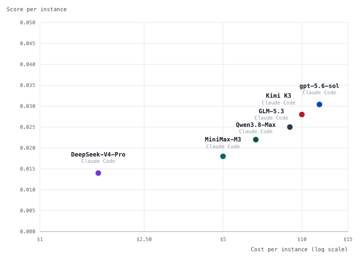

# BIOPSY-Bench

**A realistic benchmark for agentic reverse engineering.**

We synthesize analysis targets and couple them into real-world open-source projects, build and harden the resulting programs, and package each artifact together with its verifier as a runnable [Harbor](https://github.com/harbor-framework/harbor) task that agents must solve from the binary alone. Every agent submission is then checked automatically by the deterministic verifier.

## Scenarios

BIOPSY-Bench covers five scenarios. Across all five, we require **verifiable outcomes rather than explanations alone**. For example, a patch-diffing solution supplies a triggering input, a protocol-reconstruction solution supplies an executable client, and a firmware-analysis solution supplies a verdict backed by recovered artifacts and observed behavior.

| Scenario                | Agent objective                                                                                                                                                                                                                                       |
|-------------------------|-------------------------------------------------------------------------------------------------------------------------------------------------------------------------------------------------------------------------------------------------------|
| Protection assessment   | defeat protection layers on a binary to recover license-verification logic and derive a valid key                                                                                                                                                     |
| Malware analysis        | reverse a trojanized build on an already-compromised host, deliver a patched binary that no longer detonates but keeps the carrier's genuine behavior, and a cleanup script that removes the infection's artifacts                                    |
| Protocol reconstruction | reconstruct an undocumented wire protocol from a stripped binary and prove the reconstruction by interoperating with the binary                                                                                                                       |
| Firmware analysis       | unpack a real OpenWrt firmware image that may carry obfuscated layouts, decoy material, or vendor encryption, recover the filesystem, identify the components and architecture, and deliver an engagement verdict backed by emulation-proven findings |
| Patch diffing           | diff two builds of the same program, localize the security-relevant change, characterize the root cause, produce a differential trigger that cleanly separates the pair                                                                               |

## Evaluation

All tasks and agents share a single Claude Code scaffold. Performance is reported as pass@5 under a budget of two hours per attempt. Scoring is fully automated and deterministic, with an oracle solution earning 1.0, a no-op solution earning 0.0, and anti-cheating invariants keeping the ground truth out of plaintext.

On the current task set, six frontier models driven through the shared scaffold score between **0.01 and 0.03** per instance, at per-instance costs ranging from roughly **$2 to $12**. Higher spend buys only marginal gains.



## Task Catalog

Each scenario directory holds its finished and verified task instances.

### Protection Assessment

Five protected builds of real programs, each requiring the full protection chain to be defeated.

| Task                                                                                         | Created    | Difficulty | Objective                                                                                                                                   |
|----------------------------------------------------------------------------------------------|------------|------------|---------------------------------------------------------------------------------------------------------------------------------------------|
| [`ddnet-19.9-license-gate`](protection-assessment/ddnet-19.9-license-gate)                   | 2026-09-19 | expert     | defeat the packed, anti-debug-hardened, interlock-guarded chain to recover the headless server's startup entitlement key                    |
| [`stk-code-1.5-premium-unlock`](protection-assessment/stk-code-1.5-premium-unlock)           | 2026-09-19 | expert     | defeat the packed, anti-debug-hardened, interlock-guarded chain to unlock premium story, challenge, kart, and track content in SuperTuxKart |
| [`wesnoth-1.19.26-save-entitlement`](protection-assessment/wesnoth-1.19.26-save-entitlement) | 2026-09-19 | expert     | defeat the xollvm-obfuscated, packed, anti-debug-hardened chain to recover save-data entitlement in Battle for Wesnoth                      |
| [`ffmpeg-9.0.1-transcode-unlock`](protection-assessment/ffmpeg-9.0.1-transcode-unlock)       | 2026-09-19 | expert     | defeat the stealth-UPX-packed, anti-debug-hardened, xollvm-obfuscated chain to unlock the commercial transcoding tier of the protected tool |
| [`nginx-1.31.3-tier-license`](protection-assessment/nginx-1.31.3-tier-license)               | 2026-09-19 | expert     | defeat the UPX, xollvm, and interlock chain on the protected web server to forge the load-balancing tier's activation key                   |

### Malware Analysis

Five trojanized builds of real network-facing carriers, each hiding its payload behind stealth UPX packing and obfuscated strings, with anti-debug present on the httpd build. The deliverable is a patched binary that keeps the carrier's genuine behavior but no longer detonates, plus a cleanup script that removes the infection's artifacts.

| Task                                                                            | Created    | Difficulty | Objective                                                                                                                                                                             |
|---------------------------------------------------------------------------------|------------|------------|---------------------------------------------------------------------------------------------------------------------------------------------------------------------------------------|
| [`httpd-2.4.68-cred-exfil`](malware-analysis/httpd-2.4.68-cred-exfil)           | 2026-10-05 | hard       | defeat stealthed UPX packing, anti-debug, and string obfuscation to strip the credential exfiltration from the trojanized shared-hosting web daemon while keeping it a working server |
| [`busybox-1.36.1-nc-dropper`](malware-analysis/busybox-1.36.1-nc-dropper)       | 2026-10-06 | hard       | defeat UPX-stealth packing and string obfuscation to strip the dropper-bundle exfiltration from the trojanized BusyBox while keeping the multi-tool working                           |
| [`openssh-9.9p2-sshkey-harvest`](malware-analysis/openssh-9.9p2-sshkey-harvest) | 2026-10-06 | expert     | defeat stealthed UPX packing and an obfuscated payload to strip the key harvest from the trojanized SSH client while keeping genuine behavior                                         |
| [`socat-1.8.0.2-covert-relay`](malware-analysis/socat-1.8.0.2-covert-relay)     | 2026-10-06 | expert     | defeat stealth packing and string obfuscation to strip the covert relay from the trojanized network tool while keeping genuine behavior                                               |
| [`stunnel-5.80-tls-beacon`](malware-analysis/stunnel-5.80-tls-beacon)           | 2026-10-06 | hard       | defeat whole-binary stealth packing and string obfuscation to strip the TLS beacon from the trojanized tunnel while keeping genuine behavior                                          |

### Protocol Reconstruction

Five carriers spanning multi-envelope, bit-packed, and TLV wire formats. Every task is host-bound, with wire material split across the protocol engine (Tigress-VM protected in the mosh and asterisk builds, compiled plainly in the rest), a masked second translation unit, and the real configuration state of the carrier, together with per-connection frame-material rolling. The deliverable is an interoperating client judged by a multi-element session ladder and a 13-probe robustness battery.

| Task                                                                               | Created    | Difficulty | Objective                                                                                                                         |
|------------------------------------------------------------------------------------|------------|------------|-----------------------------------------------------------------------------------------------------------------------------------|
| [`mosh-1.4.0-roamlink`](protocol-reconstruction/mosh-1.4.0-roamlink)               | 2026-09-07 | expert     | reverse the VM-carried multi-envelope bit-packed protocol with seeded-prime MODP sessions and then interoperate                   |
| [`asterisk-23.4.1-trunkline`](protocol-reconstruction/asterisk-23.4.1-trunkline)   | 2026-09-07 | expert     | reverse the VM-carried multi-envelope varint-framed protocol and then interoperate                                                |
| [`samba-4.24.6-fileport`](protocol-reconstruction/samba-4.24.6-fileport)           | 2026-09-07 | expert     | reverse the bit-packed protocol with HTTP-mimicking chaff, a static embedded keystream, and no key exchange and then interoperate |
| [`strongswan-6.0.7-tunnelkey`](protocol-reconstruction/strongswan-6.0.7-tunnelkey) | 2026-09-07 | hard       | reverse the TLV protocol with seeded-prime MODP sessions and a private extract-expand KDF behind a settings-parser material site  |
| [`mariadb-12.3.3-binlatch`](protocol-reconstruction/mariadb-12.3.3-binlatch)       | 2026-09-16 | expert     | reverse the mixed-endianness single-checksum protocol with seeded-prime MODP sessions and a session-derived stream                |

### Firmware Analysis

Five images across five device classes (Atheros big-endian MIPS router, SOHO router, MediaTek Filogic aarch64 router, Marvell Armada NAS, and Qualcomm IPQ40xx enterprise AP), each requiring the agent to unpack, inventory, and analyze the image, with a scenario verdict that must be backed by emulation-proven findings.

| Task                                                                                                                     | Created    | Difficulty | Objective                                                                                                                                                                                                              |
|--------------------------------------------------------------------------------------------------------------------------|------------|------------|------------------------------------------------------------------------------------------------------------------------------------------------------------------------------------------------------------------------|
| [`tplink-archer-c7-v2-v3.15.3-capability-sweep`](firmware-analysis/tplink-archer-c7-v2-v3.15.3-capability-sweep)         | 2026-10-11 | hard       | sweep the big-endian MIPS router image for an undocumented backdoor capability (a magic account and marker daemon reaching a TEST-NET endpoint) and rule PRESENT or ABSENT with image-backed evidence                  |
| [`dlink-dir-878-a1-v1.20B05-covert-channel-sweep`](firmware-analysis/dlink-dir-878-a1-v1.20B05-covert-channel-sweep)     | 2026-09-04 | hard       | sweep the obfuscated-layout image for an undocumented listener, beacon, or magic-port responder and rule PRESENT or ABSENT with image-backed evidence                                                                  |
| [`glinet-gl-mt6000-v4.7.0-upgrade-decrypt-recovery`](firmware-analysis/glinet-gl-mt6000-v4.7.0-upgrade-decrypt-recovery) | 2026-10-11 | expert     | recover the upgrade-chain key material from an older plaintext update of the same device line, decrypt and inventory the newest encrypted aarch64 image, and deliver an emulation-proven verdict                       |
| [`buffalo-ls220de-v1.86-exploitability-review`](firmware-analysis/buffalo-ls220de-v1.86-exploitability-review)           | 2026-09-28 | hard       | prove that CVE-2026-22903 is exploitable as shipped on the NAS image, requiring vulnerable code to be present and a trigger to be demonstrated, not merely vulnerability on paper                                      |
| [`aruba-ap-303-v8.10.0.13-supply-chain-intake`](firmware-analysis/aruba-ap-303-v8.10.0.13-supply-chain-intake)           | 2026-10-11 | hard       | run a supply-chain intake on the enterprise-AP image, inventory the components and verify their provenance and versions against release history (dnsmasq 2.91 against the six-CVE wave), and rule AUTHENTIC or SUSPECT |

### Patch Diffing

Five stripped build pairs under five distinct engagement scenarios, covering backport check, staged-rollout audit, embargo response, exploit replay, and bounty adjudication. The required deliverable is always a differential trigger, a single crafted input that cleanly separates the two builds under the canonical invocation of the task.

| Task                                                                                         | Created    | Difficulty | Objective                                                                                                                                                                                                    |
|----------------------------------------------------------------------------------------------|------------|------------|--------------------------------------------------------------------------------------------------------------------------------------------------------------------------------------------------------------|
| [`git-2.49.0-push-remoteref-leak`](patch-diffing/git-2.49.0-push-remoteref-leak)             | 2026-10-05 | hard       | in a backport check, decide whether the shipped git build already carries the just-published upstream fix for the push remote-ref leak, and demonstrate any gap with a differential trigger                  |
| [`php-8.3.16-enum-constant-uaf`](patch-diffing/php-8.3.16-enum-constant-uaf)                 | 2026-10-05 | expert     | in a bounty adjudication, decide whether the submitted crash report of the enum-constant use-after-free is a genuine in-scope vulnerability that the update actually closes, and rule out a coincidental fix |
| [`qemu-10.0.0-sriov-vf-overflow`](patch-diffing/qemu-10.0.0-sriov-vf-overflow)               | 2026-10-05 | medium     | for rollout sign-off, produce the differential-risk evidence, with one input demonstrating the SR-IOV VF overflow gap between the fleet build and the about-to-ship build                                    |
| [`ruby-3.4.1-pattern-parse-leak`](patch-diffing/ruby-3.4.1-pattern-parse-leak)               | 2026-10-05 | hard       | in an embargo response, provide go or no-go evidence on whether the release candidate is exploitable through the pattern-parse leak that the about-to-lift advisory will name                                |
| [`unbound-1.22.0-keytrap-ds-grind`](patch-diffing/unbound-1.22.0-keytrap-ds-grind)           | 2026-10-05 | expert     | in an exploit replay, carry the KeyTrap technique from a public write-up onto the fleet's shipped-versus-fixed pair as a trigger that misbehaves only on the build the fleet still runs                      |

## Task Package Layout

Every task directory shares the same core shape, with scenario-specific extras under environment/ where the scenario needs them (for example protection/ in protection-assessment, commits/ and checkpoint/ in patch-diffing, evasion/ in malware-analysis, testdata/ in protocol-reconstruction, or the firmware image in firmware-analysis).

```text
<scenario>/<task>/
├── task.toml              # Harbor manifest with name, description, difficulty, verifier limits, and agent limits
├── instruction.md         # the brief that the solving agent reads
├── README.md              # per-challenge README
├── environment/           # agent-side Dockerfile, docker-compose.yaml, and scenario-specific material
├── solution/              # held-out oracle with solve.sh and ground_truth/
└── tests/                 # verifier side with Dockerfile, docker-compose.yaml, and test.sh
```

## Usage

Every task directory ships as a self-contained [Harbor](https://github.com/harbor-framework/harbor) task package, so agents are evaluated with the standard Harbor workflow. To test your own agent against BIOPSY-Bench, install Harbor and point it at a scenario directory or an individual task.

```bash
harbor run --dataset <scenario-or-task-directory> --agent <agent> --model <model>
```

For installation instructions, supported agents and models, and execution options such as cloud providers and parallel runs, refer to the [Harbor](https://github.com/harbor-framework/harbor) repository and its documentation.

## License

The benchmark's own content (task scaffolding and evaluation data) is licensed under [**GPL-3.0**](LICENSE). Commercial use is permitted under its copyleft terms, so recipients must receive corresponding source and modifications carry the same license.

Third-party software keeps its upstream license. The carrier programs and embedded libraries inside each task environment are redistribution builds of their upstream releases (GPL-2, GPL-3, LGPL, MIT, BSD, Apache-2.0, zlib, and similar), and corresponding sources or binaries ship alongside every task. Upstream names and trademarks belong to their projects. The benchmark is provided "AS IS", without warranty of any kind.
